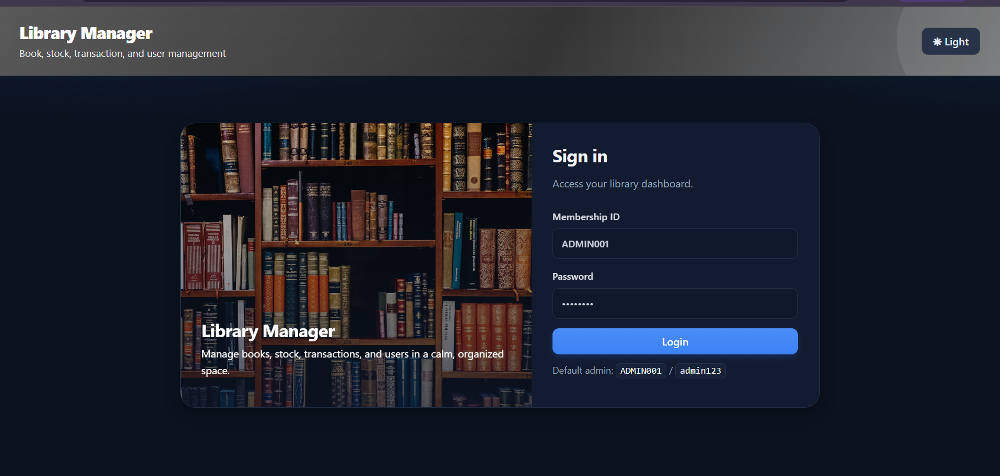
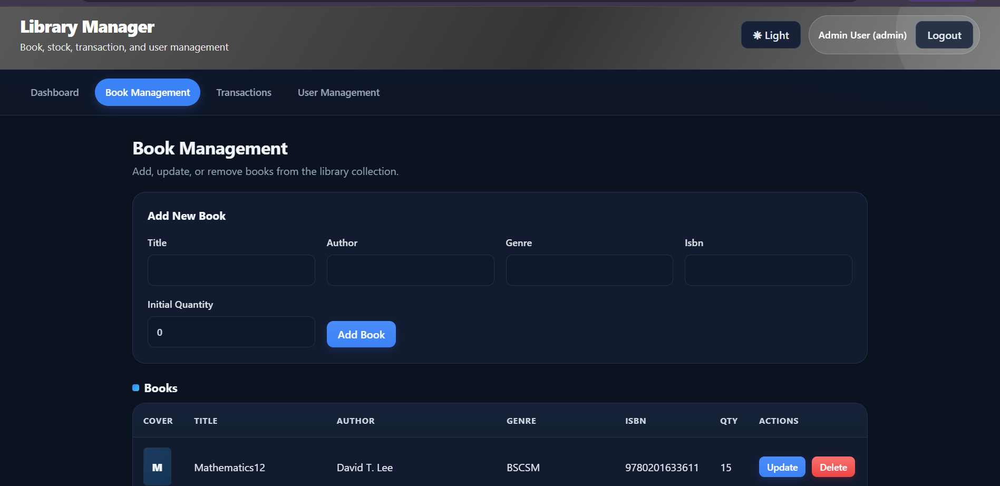
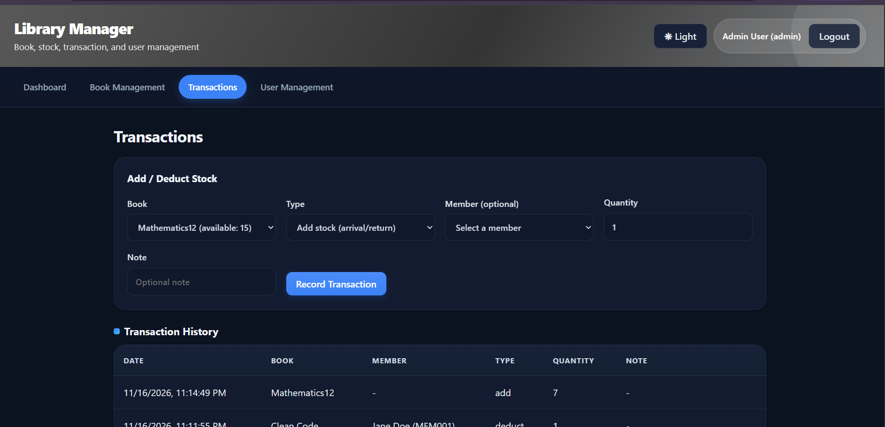
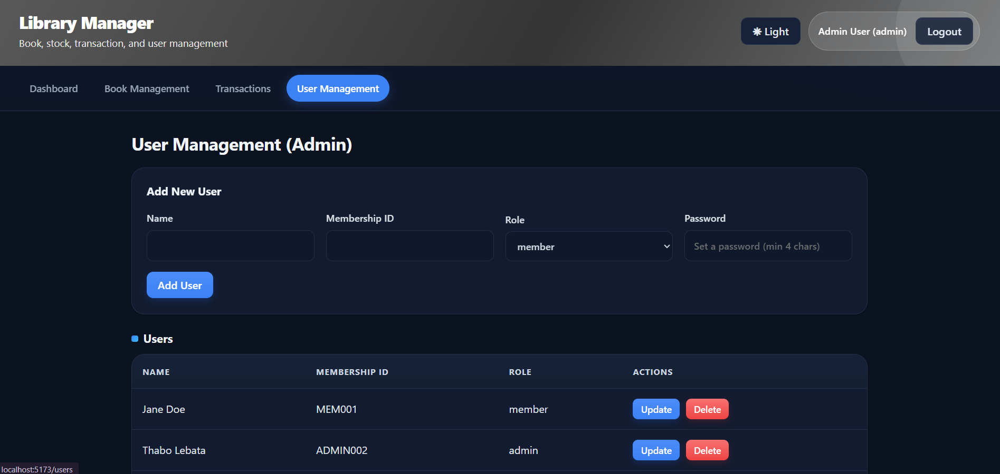

# Web Application Development - Library Manager (BIWA2110)

This repository contains a React frontend and Express + PostgreSQL backend for the individual assignment, matching the required technology stack.

## Project Structure

- `frontend/` - React app (Vite, JSX, components, hooks, React Router, Fetch API)
- `backend/` - Express.js REST API with PostgreSQL database integration

## Requirements Covered

- **React frontend:** `useState`, `useEffect`, reusable components, controlled forms with validation, React Router navigation, Fetch API CRUD integration
- **Express backend:** RESTful CRUD routes for `/books`, `/transactions`, `/users`, plus `/login`
- **Database (PostgreSQL):** stores books, users, and transaction records; tracks stock levels and borrowing/stock history
- **Middleware:** `express.json()` and `cors`
- **Features:** book management, availability/stock transactions, user management/login, dashboard with low-stock highlighting (< 2 copies)

## Prerequisites

- Node.js and npm
- **PostgreSQL** server running and accessible

## Backend Setup (Express + PostgreSQL)

1. Create a PostgreSQL database (example: `library_db`).
2. Configure environment variables:
   ```bash
   cd backend
   copy .env.example .env
   ```
   Edit `backend/.env` and set `DATABASE_URL` (or the individual `DB_*` variables) to your PostgreSQL credentials.
3. Install dependencies and start the server:
   ```bash
   npm install
   npm start
   ```
   - API runs on `http://localhost:5000` by default.
   - On startup, `backend/schema.sql` is applied automatically (creates tables and seeds a default admin user).

**Default admin login:** Membership ID `ADMIN001`, Password `admin123`

## Frontend Setup (React)

```bash
cd frontend
npm install
npm run dev
```

- Dev server runs on `http://localhost:5173` by default.
- Frontend API base: `http://localhost:5000/api` (override with `VITE_API_BASE` in `frontend/.env` if needed).

## API Endpoints

- `POST /api/login`
- `GET, POST /api/books` | `PUT, DELETE /api/books/:id`
- `GET, POST /api/transactions`
- `GET, POST /api/users` | `PUT, DELETE /api/users/:id`
- `GET /api/health`

## How to Track Data in the Database (PostgreSQL)

You can inspect the PostgreSQL database directly to track users, books, stock levels, and transaction/borrowing activity.

### 1. Make sure PostgreSQL is running
- Ensure the PostgreSQL service is running (e.g. `postgresql-x64-18`).
- The backend must be configured with valid credentials in `backend/.env` (database: `library_db`).

### 2. Connect to the database
**Option A – SQL Shell (psql):** open **SQL Shell (psql)** from the Start menu and enter:
- Server: `localhost`
- Database: `library_db`
- Port: `5432`
- Username: `postgres`
- Password: *(your PostgreSQL password)*

**Option B – PowerShell/Command Prompt:**
```powershell
psql -h localhost -p 5432 -U postgres -d library_db
```
If `psql` is not recognized, use the full path (adjust version if needed):
```powershell
& "C:\Program Files\PostgreSQL\18\bin\psql.exe" -h localhost -p 5432 -U postgres -d library_db
```
A successful connection shows: `library_db=#`

### 3. View tables and structure
```sql
\dt                 -- list tables (users, books, transactions)
\d users            -- view users columns
\d books            -- view books columns
\d transactions     -- view transactions columns
```

### 4. Useful tracking queries
**All users:**
```sql
SELECT id, name, membership_id, role, created_at
FROM users
ORDER BY id;
```

**Track user activity/transactions (who did what, when, to which book):**
```sql
SELECT
  t.id,
  t.created_at,
  t.type,
  t.quantity,
  u.name AS user_name,
  u.membership_id,
  b.title AS book_title,
  b.quantity AS current_stock,
  t.note
FROM transactions t
LEFT JOIN users u ON t.user_id = u.id
LEFT JOIN books b ON t.book_id = b.id
ORDER BY t.created_at DESC, t.id DESC;
```

**Activity for a specific user (replace membership ID):**
```sql
SELECT t.created_at, u.name, u.membership_id, t.type, t.quantity, b.title, t.note
FROM transactions t
JOIN users u ON t.user_id = u.id
JOIN books b ON t.book_id = b.id
WHERE u.membership_id = 'MEM001'
ORDER BY t.created_at DESC;
```

**Current book stock / low stock (< 2):**
```sql
SELECT id, title, author, isbn, quantity,
       CASE WHEN quantity < 2 THEN 'LOW STOCK' ELSE 'OK' END AS status
FROM books
ORDER BY quantity ASC, title;
```

**Transaction history for a specific book (replace ISBN):**
```sql
SELECT t.created_at, b.title, t.type, t.quantity, u.name AS performed_by, t.note
FROM transactions t
JOIN books b ON t.book_id = b.id
LEFT JOIN users u ON t.user_id = u.id
WHERE b.isbn = '9780132350884'
ORDER BY t.created_at DESC;
```

### 5. Demo tip
Perform an action in the app (e.g. login, add/deduct stock, add/update user), then rerun the relevant query to show the change recorded in the database. Use `\q` to exit `psql`.

## Notes

- A running PostgreSQL instance and correct credentials in `backend/.env` are required for the backend to start and for the frontend to fetch data.
- Use the Vite dev server (`npm run dev`) to run the frontend; do not open `index.html` directly with a static live server.
## Screenshots

### Login


### Dashboard


### Book Management


### Transactions


### User Management
